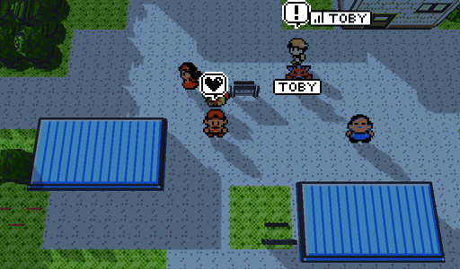
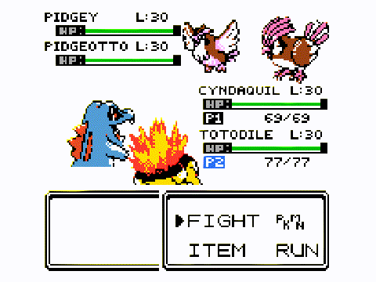
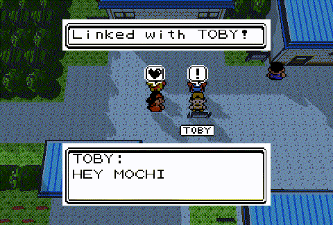
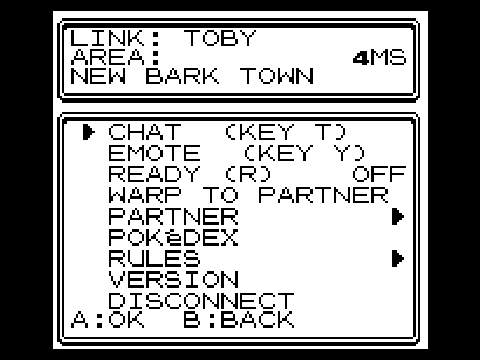
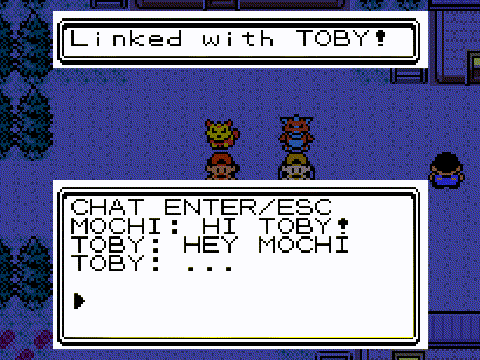
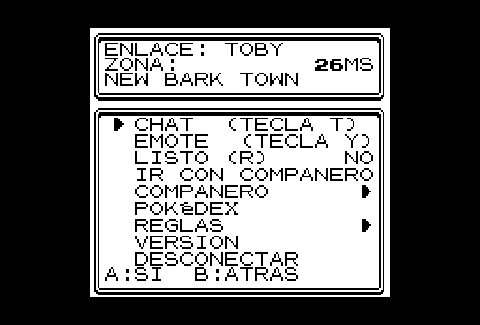

<a id="english"></a>

<h1 align="center">PkMultiplayer</h1>

<p align="center"><b>Two-player online co-op for Gen2Recomped: play through Pokémon Gold, Silver,<br>
Crystal (and Red/Blue/Yellow) with a friend, in the same world.</b></p>

<p align="center">
  <a href="https://github.com/Mochx-007/PkMultiplayer/releases/latest"></a>
  <a href="https://github.com/Mochx-007/PkMultiplayer/releases"></a>
  <a href="https://github.com/UNDERdecoded/Gen2Recomped"></a>
  
  
  <a href="LICENSE"></a>
</p>

<p align="center">🇬🇧 English · <a href="#espanol">🇪🇸 Español</a></p>

Two players, one Johto. You see each other walk, chat (**T**) and emote (**Y**), live
the story's events together, trade through the Cable Club and fight trainers as a
**2-vs-2 double battle** in lockstep, with HeartGold/SoulSilver's doubles rules.

**Not an MMO:** it's your own playthrough, with a friend in it. No third-party
servers — one of you hosts the session from inside the game.

It is a **mod** for the official [Gen2Recomped](https://github.com/UNDERdecoded/Gen2Recomped):
no fork of the game to download, just this zip.

<p align="center">
  
</p>

| 2-vs-2 double battles | Emotes and names, in 3D too |
|---|---|
|  |  |
| **Co-op menu** | **Live chat** |
|  |  |

### What makes it different

- 📖 **The story, together**: events, world items and badges happen in both saves at once.
- ⚔️ **2-vs-2 doubles against the game's own trainers and leaders**, in lockstep, with HeartGold/SoulSilver's doubles rules.
- 🔗 **Soul Link** (the two-player Nuzlocke), a **linked Day-Care** and the **Battle Tower in multi** (Crystal).
- 🐾 **Your lead Pokémon follows you**, HGSS-style, and your partner sees it.
- 🌐 **English and Spanish**, and it works in DramaticShapes' **3D** world too.

## Installation

1. Have the **official Gen2Recomped** installed, with your Gold/Silver/Crystal ROM already imported.
2. Download `PkMultiplayer-<version>.zip` from
   [Releases](https://github.com/Mochx-007/PkMultiplayer/releases).
3. In the launcher, open the **MODS** tab and press **Import mod .zip**, or drop the
   zip on the window. Make sure the mod is enabled.
4. Start the game. **Both players** need the mod, on the same version.

The launcher tells you when a new version is out (the mod checks its GitHub releases).

## Connecting

- **Same network (LAN):** one player presses START → **CO-OP ONLINE** → **HOST**. The
  host sees a short **code** (for example `30AG-0B4`) and their IP. The other goes to
  **JOIN** → **TYPE A CODE** and types the code (or pastes it with **Ctrl+V**), or
  **TYPE THE IP** to dial the IP in with the D-pad.
- **Over the internet:** use [ZeroTier](https://www.zerotier.com/) (a free virtual
  network). Both join the same network: the host's code already carries their
  ZeroTier IP. The port is **7777**; change it on the **PORT** row (for example, for
  two games on the same PC).
- **JOIN** remembers the last three hosts you joined: pick one and you're in.
- If something fails, the menu gives the full reason and what to do (open the UDP
  port in the firewall, the same mod version, etc.).
- From the title screen you can also pick **NEW CO-OP GAME** or **CONTINUE CO-OP** to
  start or carry on a game together.

## On a phone (iOS / Android)

| | |
|---|---|
| Chat | START → CO-OP ONLINE → **CHAT**; in a double battle, **SELECT**. The phone's keyboard opens, its return key sends, and **A** brings the keyboard back if you closed it. |
| Emotes | START → CO-OP ONLINE → **EMOTE** |
| ZeroTier IP | shown on its own when the ZeroTier app is connected (networks on ZeroTier Central's automatic ranges) |

## Language

The mod speaks English and Spanish: MODS → PkMultiplayer → OPTIONS →
**LANGUAGE / IDIOMA** (**AUTO** follows the language you translate the game to in the
launcher; **ESPANOL** pins Spanish).

## Original emotes (optional)

Out of the box the emotes are bubbles the mod draws. For **the cartridge's own**:
launcher → **MODS** → on PkMultiplayer press **IMPORT** and pick your Gold, Silver or
Crystal ROM. The mod cuts the 8 bubbles out once, on your device (the trainers'
original "!" comes back too). The mod ships nothing from the ROM.

## What's included

| | |
|---|---|
| Shared world | your partner walks on your map, with their name above them |
| Walking Pokémon | your first (non-fainted) Pokémon walks behind you, HeartGold/SoulSilver-style, with its cartridge icon; talk to it with **A**. Your partner sees it too. It sparkles when shiny, and when it loves you it sometimes finds items (a **!** above it: talk to it). Switch it off under MODS → PkMultiplayer → OPTIONS → POKEMON FOLLOWS YOU. Gold/Silver/Crystal only |
| Chat | **T** key (also during a double battle); on phones, see above |
| Emotes | **Y** key |
| Double battles | against trainers, in lockstep, with HeartGold/SoulSilver's doubles rules and a foe AI written for doubles |
| Shared story | what one player lives, the other lives too; important battles ask first. In Red/Blue/Yellow too: the leaders' badges and TMs, the Mt. Moon fossil (one each), gifts. Gold/Silver and Crystal don't share the story (they number their events differently); the rest of the co-op works |
| Ready / Not ready | **R** key (or **READY** in the menu): your partner sees **OK** next to your name before a big battle |
| Co-op result | after each co-op double, for a few seconds at the top: each player's knockouts and EXP, and the Pokémon that did the most |
| Where they are | if your partner is on another map, an arrow on the screen edge points their way and the place's name shows at the top |
| Extras | Cable Club trades, P1 vs P2, items for your partner's Pokémon, a shared Bug-Catching Contest and Hall of Fame, a shared clock |
| Warp | only to towns you've already visited (like FLY); your partner has to accept, and it recharges in 10 minutes |
| Wild Pokémon together | **TEAM UP WILD** rule: a wild Pokémon that jumps you while walking with your partner nearby (8 steps, same map) asks them to join, and you fight a double against it and its twin. Together there are no Poké Balls; **RUN** takes you both out |
| Watch their battle | **WATCH**: a little screen with your partner's battle, live |
| Visitors | up to 4 more players walk into the host's world with **VISIT** (session port + 1): they walk, chat and emote with everyone; each plays their own game |
| Soul Link | **SOUL LINK** rule: the two-player Nuzlocke. Each player's first catch in an area is bound to the other's; if one falls, both fall and can't be healed. **SOUL LINKS** shows the pairs |
| Linked Day-Care | **LINK DAYCARE** rule: with a Pokémon in your Day-Care and another in your partner's, theirs is the second parent in yours. Each takes their own egg; no Pokémon leaves its save |
| Battle Tower | (Crystal) each battle of a challenge can be a co-op double: your partner joins from wherever they are, with Pokémon under the level cap, and their team comes back as it went in |
| Mystery Gift | **MYSTERY GIFT**: once a day per partner, each game picks an item for the other |
| Pokédex | **POKéDEX**: what your partner has and you don't, and the other way round. **SHARE DEX** rule: their catches count as SEEN in yours |
| Pokégear | your partner tops the phone list (calling them opens the chat and rings their Pokégear) and their marker blinks on the map |
| Reconnecting | the game remembers the last link: the host listens again and the guest calls back on its own (**AUTO RECONNECT** option); **RECONNECT** row in the menu. After a drop, what was sent in those seconds arrives once you're back, only once, and only the partner's own game can take their seat |

The co-op menu (START → CO-OP ONLINE while linked), nine rows without scrolling:
CHAT, EMOTE, READY, WARP TO PARTNER, **PARTNER ▶** (ITEM FOR PARTNER, WATCH, TRADE,
BATTLE P1 VS P2, MYSTERY GIFT), POKéDEX, **RULES ▶** (STORY SYNC, TEAM UP WILD, SHARE
DEX, LINK DAYCARE, PARTNER HEAL, SOUL LINK, SOUL LINKS; the box above explains the
highlighted rule), VERSION and DISCONNECT. B goes back a page. **VERSION** opens the
link status: ping, loss, resent messages, reconnections, battle desyncs corrected and
both players' versions. Not linked: RECONNECT, HOST, JOIN, VISIT, PORT, STORY SYNC,
EMOTE, VERSION, EXIT. The rules are saved with the game.

**Move animations** land on the Pokémon actually there, in single battles too: the
cartridge aims at the center of the 56×56 box, so against a small Pokémon (Pidgey,
Natu...) the hit landed in the air.

## Known limitations

- It only works in **Gen 1 and Gen 2** games. In the rest the mod loads but does nothing.
- Without your ROM imported for the mod, the emotes are bubbles the mod draws (see
  "Original emotes").
- With the voxel mod (DramaticShapes) single battles stay in 3D, but co-op doubles are
  played on the classic screen (its 3D only knows single battles).
- Visitors don't share the story, battles or items: only the world, the chat and the emotes.
- The walking Pokémon uses the party-menu icon (two frames, no back view), which is
  what the cartridge has; it hides on the bike and while surfing.
- If Gen2Recomped changes the functions the mod touches a lot, the mod notices and
  leaves that module unpatched (you'll see it in `log.txt`). Then PkMultiplayer needs
  an update.

## Logs

`coop.log` and `log.txt` are in the game's save folder (Linux:
`~/.local/share/Gen2Recomp/`, Windows: `%APPDATA%\Gen2Recomp\`). If something fails,
open an [issue](https://github.com/Mochx-007/PkMultiplayer/issues/new/choose) and attach
both players' `coop.log`.

---

<a id="espanol"></a>

# PkMultiplayer en español

<p align="center"><a href="#english">🇬🇧 English</a> · 🇪🇸 Español</p>

Juega **Pokémon Oro, Plata o Cristal** (y Rojo/Azul/Amarillo) con un amigo en el
mismo mundo: se ven caminar, chatean, viven los eventos de la historia juntos y
pelean contra los entrenadores en **combates dobles 2 contra 2**.

**No es un MMO:** es tu partida de siempre, con un amigo dentro. Sin servidores
de nadie: uno de los dos aloja la sesión desde su propio juego.

Es un **mod** para el [Gen2Recomped](https://github.com/UNDERdecoded/Gen2Recomped)
oficial. No hace falta descargar ningún fork del juego, solo este zip.

### Lo que lo hace distinto

- 📖 **La historia, juntos**: los eventos, objetos del mundo y medallas se viven a la vez en las dos partidas.
- ⚔️ **Dobles 2 contra 2 contra los entrenadores y líderes del juego**, sincronizados, con reglas de HeartGold/SoulSilver.
- 🔗 **Soul Link** (el Nuzlocke de dos), **guardería compartida** y **Torre de Combate en dúo** (Cristal).
- 🐾 **Tu Pokémon te sigue** como en HGSS, y tu compañero lo ve.
- 🌐 **Español e inglés**, y funciona también con el mundo **3D** de DramaticShapes.

## Instalación

1. Ten el **Gen2Recomped oficial** instalado, con tu ROM de Oro/Plata/Cristal ya importada.
2. Descarga `PkMultiplayer-<versión>.zip` de
   [Releases](https://github.com/Mochx-007/PkMultiplayer/releases).
3. En el launcher, abre la pestaña **MODS** y pulsa **Import mod .zip**, o
   arrastra el zip a la ventana. Comprueba que el mod está activado.
4. Abre el juego. Los **dos jugadores** necesitan el mod, y en la misma versión.

El launcher te avisa cuando sale una versión nueva (el mod comprueba sus
releases de GitHub).

## Cómo conectarse

- **Misma red (LAN):** uno pulsa START → **CO-OP ONLINE** → **HOST**. Al host
  le aparece un **código** corto (por ejemplo `30AG-0B4`) y su IP. El otro
  entra en **JOIN** → **TYPE A CODE** y escribe el código (o lo pega con
  **Ctrl+V**), o **TYPE THE IP** para marcar la IP con la cruceta.
- **Por internet:** usen [ZeroTier](https://www.zerotier.com/) (una red
  virtual gratuita). Únanse los dos a la misma red: el código del host ya
  lleva su IP de ZeroTier. El puerto es el **7777**; se cambia en la fila
  **PORT** (por ejemplo, para dos juegos en el mismo PC).
- **JOIN** recuerda los tres últimos hosts a los que te uniste: elige uno y listo.
- Si algo falla, el menú dice el motivo completo y qué hacer (abrir el puerto
  UDP en el firewall, la misma versión del mod, etc.).
- Desde el título también pueden elegir **NEW CO-OP GAME** o **CONTINUE CO-OP**
  para empezar o seguir una partida juntos.

## En el móvil (iOS / Android)

| | |
|---|---|
| Chat | START → CO-OP ONLINE → **CHAT**; en un combate doble, **SELECT**. Se abre el teclado del teléfono, la tecla de retorno envía y **A** vuelve a sacar el teclado si lo cerraste. |
| Emotes | START → CO-OP ONLINE → **EMOTE** |
| IP de ZeroTier | se muestra sola si la app de ZeroTier está conectada (redes con los rangos automáticos de ZeroTier Central) |

## Idioma

El mod habla español: MODS → PkMultiplayer → OPTIONS → **LANGUAGE / IDIOMA**
(**AUTO** sigue el idioma al que traduces el juego en el launcher; **ESPANOL**
lo fija). Para ver las tildes y la ñ en píxeles, instala también un mod de
glifos españoles; sin él, el texto sale sin tildes.

<p align="center"></p>

## Emotes originales (opcional)

Sin nada más, los emotes son globos dibujados por el mod. Para tener **los
del cartucho**: launcher → **MODS** → en PkMultiplayer pulsa **IMPORT** y
elige tu ROM de Oro, Plata o Cristal. El mod recorta los 8 globos una vez en
tu dispositivo (también vuelve el "!" original de los entrenadores). El mod
no incluye nada del ROM.

## Qué incluye

| | |
|---|---|
| Mundo compartido | ves a tu compañero en tu mapa, con su nombre encima |
| Pokémon que te sigue | tu primer Pokémon (no debilitado) camina detrás de ti, como en HeartGold/SoulSilver, con su icono del cartucho; háblale con **A**. Tu compañero también lo ve. Si es shiny destella, y si te quiere mucho a veces encuentra objetos (un **!** encima: háblale). Se apaga en MODS → PkMultiplayer → OPTIONS → POKEMON FOLLOWS YOU. Solo en Oro/Plata/Cristal |
| Chat | tecla **T** (también durante un combate doble); en móvil, ver arriba |
| Emotes | tecla **Y** |
| Combates dobles | contra entrenadores, en lockstep, con las reglas de dobles de HeartGold/SoulSilver y una IA rival pensada para dobles |
| Historia compartida | los eventos que vive uno los vive el otro; las batallas importantes se preguntan antes. También en Rojo/Azul/Amarillo: medallas y MT de los líderes, el fósil de Mt. Moon (uno para cada uno), regalos. Entre Oro/Plata y Cristal la historia no se comparte (numeran sus eventos distinto); el resto del co-op sí |
| Listo / No listo | tecla **R** (o **READY** en el menú): tu compañero ve **OK** junto a tu nombre antes de un combate grande |
| Resultado co-op | tras cada doble co-op, unos segundos arriba: los K.O. y la EXP de cada uno y el Pokémon que más hizo |
| Dónde está | si tu compañero está en otro mapa, una flecha en el borde de la pantalla apunta hacia él y arriba sale el nombre del sitio |
| Extras | intercambios por el Cable Club, P1 vs P2, objetos para los Pokémon del compañero, Concurso de Bichos y Salón de la Fama compartidos, reloj compartido |
| Warp | solo a pueblos que ya visitaste (como VUELO), tu compañero tiene que aceptar, y se recarga en 10 minutos |
| Salvajes en pareja | regla **TEAM UP WILD**: un salvaje que te sale al caminar con tu compañero cerca (8 pasos, mismo mapa) le pregunta si se une, y pelean un doble contra el salvaje y su gemelo. Juntos no hay Poké Balls; **RUN** los saca a los dos |
| Ver su combate | **WATCH**: una pantallita con el combate de tu compañero en vivo |
| Visitantes | hasta 4 jugadores más entran al mundo del anfitrión con **VISIT** (puerto de la sesión + 1): caminan, chatean y mandan emotes con todos; cada uno juega su partida |
| Soul Link | regla **SOUL LINK**: el Nuzlocke de dos. La primera captura de cada uno en un área queda unida a la del otro; si una cae, caen las dos y no se pueden curar. **SOUL LINKS** muestra las parejas |
| Guardería unida | regla **LINK DAYCARE**: con un Pokémon en tu guardería y otro en la de tu compañero, el suyo es el segundo padre en la tuya. Cada uno saca su huevo; ningún Pokémon sale de su partida |
| Torre de Combate | (Cristal) cada combate de un desafío puede ser un doble co-op: tu compañero se une desde donde esté, con Pokémon bajo el límite de nivel, y su equipo vuelve como entró |
| Regalo Misterioso | **MYSTERY GIFT**: una vez al día por compañero, cada juego elige un objeto para el otro |
| Pokédex | **POKéDEX**: lo que tiene tu compañero y tú no, y al revés. Regla **SHARE DEX**: sus capturas cuentan como VISTAS en la tuya |
| Pokégear | tu compañero encabeza la agenda (llamarlo abre el chat y le suena el Pokégear) y su marca parpadea en el mapa |
| Reconexión | la partida recuerda el último enlace: el anfitrión vuelve a escuchar y el invitado vuelve a llamar solo (opción **AUTO RECONNECT**); fila **RECONNECT** en el menú. Tras un corte, lo que se envió en esos segundos llega al volver, una sola vez, y el sitio del compañero solo lo puede ocupar su misma partida |

Menú co-op (START → CO-OP ONLINE estando conectado), nueve filas sin scroll:
CHAT, EMOTE, READY, WARP TO PARTNER, **PARTNER ▶** (ITEM FOR PARTNER, WATCH,
TRADE, BATTLE P1 VS P2, MYSTERY GIFT), POKéDEX, **RULES ▶** (STORY SYNC, TEAM UP
WILD, SHARE DEX, LINK DAYCARE, PARTNER HEAL, SOUL LINK, SOUL LINKS; el recuadro
de arriba explica la regla marcada), VERSION y DISCONNECT. B vuelve de una
página a la anterior. **VERSION** abre el estado del enlace: ping, pérdida,
mensajes reenviados, reconexiones, desfases de combate corregidos y las
versiones de los dos. Sin conectar: RECONNECT, HOST, JOIN, VISIT, PORT, STORY
SYNC, EMOTE, VERSION, EXIT. Las reglas se guardan en la partida.

Los **ataques** caen sobre el Pokémon que hay de verdad, también en combates
individuales: el cartucho apunta al centro de la caja de 56×56, y contra un
Pokémon pequeño (Pidgey, Natu...) el golpe quedaba en el aire.

## Limitaciones conocidas

- Solo funciona en juegos de **Gen 1 y Gen 2**. En el resto el mod se carga
  pero no hace nada.
- Sin tu ROM importado para el mod, los emotes son globos dibujados por el
  mod (ver "Emotes originales").
- Con el mod de vóxeles (DramaticShapes) los combates individuales siguen en
  3D, pero los dobles co-op se juegan en la pantalla clásica (su 3D solo sabe
  de combates individuales).
- Los visitantes no comparten historia, combates ni objetos: solo el mundo,
  el chat y los emotes.
- El Pokémon que te sigue usa el icono del menú de equipo (dos frames, sin
  vista de espaldas), que es lo que el cartucho tiene; se esconde en bici y
  surfeando.
- Si Gen2Recomped cambia mucho las funciones que toca el mod, el mod lo
  detecta y deja ese módulo sin parchear (lo verás en `log.txt`). En ese
  caso hay que actualizar PkMultiplayer.

## Registro (logs)

`coop.log` y `log.txt` están en la carpeta de guardado del juego
(Linux: `~/.local/share/Gen2Recomp/`, Windows: `%APPDATA%\Gen2Recomp\`).
Si algo falla, abre un [issue](https://github.com/Mochx-007/PkMultiplayer/issues/new/choose)
y adjunta el `coop.log` de los dos jugadores.

---

## How it works (for developers)

The co-op needs changes in the middle of about a hundred engine functions.
The mod carries **none of the engine's code**:

- `src/` holds the co-op modules, served to `require` under the names the
  engine asks for.
- `lib/Hooks.lua` wraps the engine functions that only need co-op code
  before or after them.
- `lib/patches/*.lua` are **edits**: where each one goes (the line, plus the
  FNV-1a hashes of the lines around it), how many lines it removes, and the
  co-op's own new lines. Lines the edit only moves or re-indents are named
  by number and hash, not copied.
- `lib/Transplant.lua` reads each engine function's source from the
  player's own copy of the game, applies the edits, and compiles the result
  in an environment that resolves the engine file's locals through the
  upvalues of its own functions. If another mod (for example the bundled
  voxel mod) already wrapped a function, the co-op version goes inside that
  wrapper and the wrapper stays in place. When upstream has changed a
  function, the edits are placed by context. If they cannot be placed, that
  module is left unpatched and the log says so.

### Tests

From a Gen2Recomped checkout:

```sh
luajit <mod>/tests/run.lua <mod>/tests/coop_lockstep.lua       # each suite
luajit <mod>/tests/run.lua <mod>/tests/patch_scope.lua         # every name resolves
PKM_EAGER=1 PKM_PRE=<mod>/tests/foreign_wrapper_pre.lua \
  luajit <mod>/tests/run.lua <mod>/tests/foreign_wrapper.lua   # another mod's wrappers survive
```

`tests/drivers/coop_smoke.lua` runs two real game instances linked over
127.0.0.1 (`PKM_ROLE=host|guest`, see the file).  So do `wild_together.lua`,
`watch_smoke.lua` and `tower_smoke.lua` (Crystal); `visit_smoke.lua` runs
three (`PKM_ROLE=host|guest|visitor`).  `tests/coop_features.lua` covers the
1.4 extras, `tests/anim_fit.lua` the move-animation fit,
`tests/coop_gen1_story.lua` Red/Blue/Yellow's shared story and
`tests/coop_ux.lua` the invite codes, menus and 1.6 extras.
`tools/run_tests.sh` runs every suite; `tools/i18n_check.py` lists on-screen
lines the Spanish catalog does not cover.

### Regenerating the patches

`tools/gen_patches.py <checkout> <upstream ref> <co-op ref>` rebuilds
`lib/patches/` from a tree with the co-op changes merged into upstream.
`tools/check_patches.py` with the same arguments checks that every function
is rebuilt byte for byte, and still is when upstream has changed it.

## License

PkMultiplayer's own files are MIT (see `LICENSE`). Gen2Recomped belongs to
its authors and is under its own license. No ROM data is included. Pokémon
is a trademark of Nintendo, Creatures Inc. and GAME FREAK Inc.
